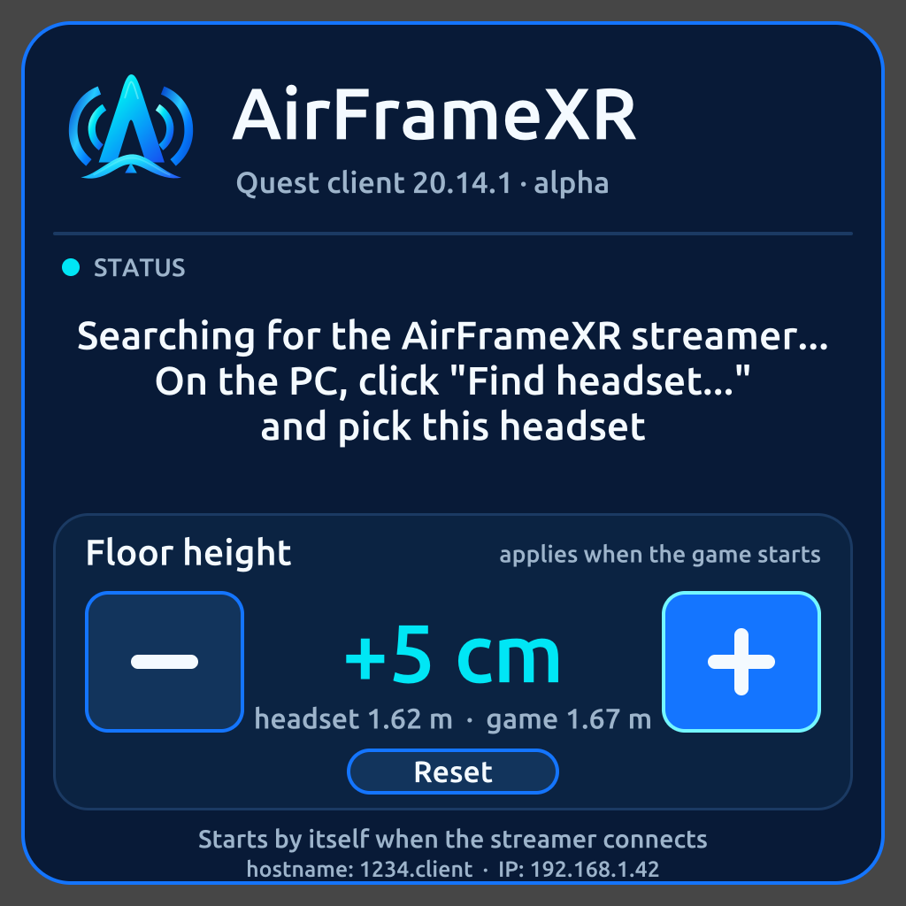

# Quest welcome panel (AirFrameXR)

Replaces the plain text HUD of the ALVR lobby. **Builds; never run on a headset.** Nothing below was seen working on a Quest.

The picture is the real rasteriser (`alvr/graphics/src/panel.rs`) run on a PC with sample text, not a screenshot from a headset. How it looks in the headset (size, readability, colours) is unchecked.

## What it shows

- **Header:** the AirFrameXR mark and name, `Quest client <our version> . ALVR <protocol version>`.
- **Status:** the connection message (searching, connecting, stream starting, errors). The "Open ALVR ... click Trust" text is now "On the PC, click Find headset... and pick this headset", the AirFrameXR streamer's pairing step (`docs/INSTALL.md` of the AirFrameXR repo).
- **Floor height**, the visionOS client's semantics: the headset's own height above the floor (live), a manual offset of -50..+50 cm in 1 cm steps (**-**, **+**, **Reset**; hold to repeat), and what the game will see (headset + offset).
- **Small print:** hostname and IP of the headset.

There is no Enter button: Quest connects by itself, the panel is the lobby and goes away when the stream starts. Dropped on purpose: the chaperone setting (the Quest boundary is a system feature with no app API), performance stats (not worth anything on the render path), "auto-connect" (nothing on Quest corresponds to them).

## Where the offset lives and is applied

- Stored on the headset in the client's `session.json` (`height_offset_cm`, missing = 0; `alvr_client_core::{height_offset_cm, set_height_offset_cm}`). The pairing data in that file is untouched. It is saved when the button is let go.
- Applied when a stream starts (`client_openxr/src/stream.rs`, `StreamContext::new`): the OpenXR `STAGE` reference space of the stream is created with its origin lowered by the offset (`interaction::get_offset_reference_space`). Head, hands and controllers sent to the PC, the views, and the submitted layer are all located in that one space, so every pose the game sees is that much higher while the picture the wearer sees does not move and the reprojection stays consistent. The visionOS client reaches the same result by adding the shift to the poses it sends and taking it out again for display; the reference-space way needs no per-pose correction.
- It is read once per stream: a change in the panel is for the next stream start (the panel is only shown between streams).

## Pointing

- Controllers: the aim pose is the ray, the trigger is the click (only when the hand has no tracked skeleton, so a controller lying on a table does not point). Hands do not point: hand pinch was removed in 1.0 (not reliable).
- A ray is drawn from the controller to the panel (cyan, white while pressed). The panel is the old HUD's four quads, 3.5 m wide at 5 m, so a ray hits it wherever the wearer looks; hit testing uses the same geometry (`panel_hit`).

## Not verified, check on the headset

1. The panel is visible, upright, readable at 5 m, and not too bright or too dark; the mark is there.
2. A controller ray appears and follows the aim; the trigger presses **-** / **+** / **Reset**; holding repeats; the value and "game" height change.
4. The headset height reads about your real eye height (1.6 m standing); if it reads 0 or garbage the lobby's `LOCAL_FLOOR` space is not what was assumed.
5. Set +10 cm, start a game: the game's floor/eye height is 10 cm higher than before, hands and head line up, nothing swims when moving the head. Then -10 and 0. The stream logs `Floor height offset: ... m` at its start.
6. Quit and relaunch the app: the offset is still there.
7. The connection messages appear in the status area and fit (longest: "Cannot connect to the streamer." + "Network error.").
8. Quest 3, Pro, Quest 2 (not tried).

Open risks: the `STAGE` space origin on some runtimes is at the floor of the guardian, so "height" differs from the lobby's `LOCAL_FLOOR` reading by the floor offset, if the two floors disagree (then the readout shows a number slightly different from the true headset height in the game; the offset itself is still applied correctly because it is relative). The aim pose of a controller held in multimodal mode may be reported while the hand is the real pointer (only a controller whose hand has no tracked skeleton points).
