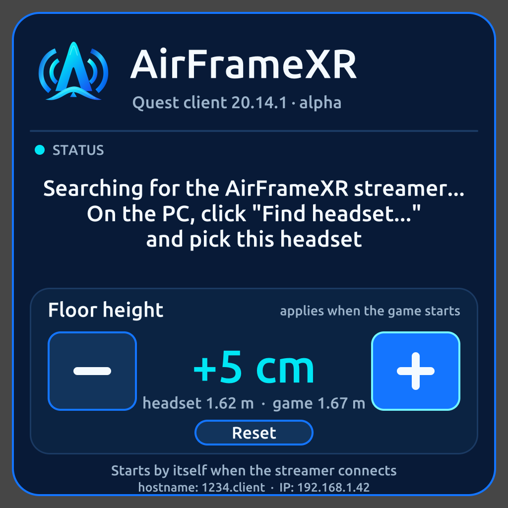

<p align="center">
  <picture>
    <source media="(prefers-color-scheme: dark)" srcset="branding/airframexr-horizontal-dark.png">
    
  </picture>
</p>

# AirFrameXR for Meta Quest

**The Quest client built for [AirFrameXR](https://github.com/jfbobier/AirFrameXR): wireless PC VR for NVIDIA cards, tuned end to
end for performance.** One stream format, one streamer, nothing else to configure around.

**Version 1.3.0 · Vulkan renderer · Quest 3 tested.** Quest Pro and Quest 2 are intended targets but have not been run (see
[What was tested](#what-was-tested)).

<p align="center">
  <br>
  <sub>The welcome panel, as the code draws it (a PC render of the real rasteriser, not a headset screenshot).</sub>
</p>

## Why this client

The AirFrameXR streamer does the heavy work on the PC: frame generation, foveated encoding, NVENC HEVC 10-bit. The headset has one
job, which is to show that stream with as little delay and as little work as possible. The stock ALVR client is built to talk to
many streamers and many headsets. This one is built for exactly one pairing, and drops everything else:

- **Renderer rewritten in Vulkan.** The OpenGL ES / EGL renderer is gone. The OpenXR session uses `XR_KHR_vulkan_enable2`: the Quest
  runtime picks the device, and the decoder's `AHardwareBuffer` frames are imported straight into Vulkan images with an immutable
  YCbCr sampler, in place of the old EGL image path. The old client was the reference, ported function by function; the deviations
  are in [`QUEST_VULKAN_PORT.md`](QUEST_VULKAN_PORT.md). On a Quest 3 it is reactive (the author's report).
- **Modern Meta platform.** OpenXR with the current Meta extensions, Android 14 target (SDK 34) and the current Horizon OS manifest
  (`horizonos.permission.HAND_TRACKING` in place of the deprecated name). Quest only: the Pico, YVR, Lynx, HTC and ByteDance
  code, loaders and workarounds were removed, about 1,500 lines. The APK is **3.5 MB** (it was 26.6 MB).
- **Colour from what the stream declares.** The AirFrameXR chain is HEVC Main10, BT.709, full range, SDR. The Quest's driver
  suggests *narrow* range for that stream, so the YCbCr conversion is created as BT.709 full range and the old shader remap is gone.
- **Aligned with AirFrameXR's field-of-view handling.** The streamer can tell the game a smaller field of view than the headset
  shows and can encode foveated, so the game renders and the encoder spends bits only where you look. The client reports the real
  per-eye field of view of the Quest and renders the stream with the field of view the streamer declares, so the picture stays
  geometrically correct under those settings. The restriction itself is decided by the streamer (see its README); this client has no
  field-of-view logic of its own yet.
- **Controllers, no pinch.** Hand pinch was tried and removed in 1.0 because it was not reliable (same decision as on the AirFrameXR
  Vision Pro client). Controllers drive the panel, the games and the desktop mirror; free hands send only the skeleton.
- **Chroma-key fix.** The HSV key tested the wrong mode number in the shader (the bug is also in stock ALVR 20.14.1).

Performance is the design goal, not a published result: there is no benchmark of this client against the old OpenGL one yet, and the
claims above about how it works are not claims about how many milliseconds it saves.

## The welcome panel

Between streams the headset shows the AirFrameXR panel instead of the stock text HUD ([`QUEST_UI.md`](QUEST_UI.md)):

- The AirFrameXR mark and name, and `Quest client 1.3 · Vulkan · ALVR 20.14.1`.
- The connection status, with the pairing step in AirFrameXR's words: *On the PC, click Find headset... and pick this headset*.
- **Floor height**: the headset's own height above the floor (live), an offset of -50 to +50 cm in 1 cm steps (**-**, **+**,
  **Reset**, hold to repeat), and the height the game will see. The offset is saved on the headset and applied when the stream
  starts, by lowering the stream's stage space.
- The headset's hostname and IP. Point with a controller ray and the trigger. The panel disappears when the stream starts.

## What was tested

By the author, on **one Meta Quest 3**, with the AirFrameXR streamer on an RTX 5090 PC:

- Vulkan rendering of the stream at 90 Hz, HEVC Main10 (10-bit), BT.709 full range.
- The RGB chroma key (green key colour).
- The welcome panel.
- Controllers, in several different games.
- The 1.0 build (pinch removed): runs well and the Vulkan rendering is reactive (the author's report, no measurements). 1.3.0 differs
  from 1.0 by the version number and the panel subtitle only.

**Not tested, so do not assume it works:** Quest Pro, Quest 2 and Quest 3S; the floor-height offset in a game; the HSV chroma key; long
sessions; wired (USB) use and the streamer's USB autolaunch; the Vulkan validation layers (no release build ran with them, so the
absence of warnings is not proof that the raw Vulkan code is correct); any field-of-view restriction on the Quest.

## Install (sideload)

Download the APK from the [releases](https://github.com/jfbobier/airframexr-metaquest/releases). It is signed with a debug key and its
package name is `airframexr.client`, so it installs next to a stock ALVR client. Pairing is stored per package: the first time, pair
it from the streamer ("Find headset...").

```
adb install -r airframexr-quest-1.3.0.apk
```

Then start the AirFrameXR streamer on the PC and start the app (it appears as **AirFrameXR**). It pairs with the AirFrameXR streamer
and is not meant for a stock ALVR server.

## Build

Linux or WSL: the Android SDK platform 34 and build-tools 34, NDK r26b (26.1.10909125), `cargo-apk`, `cargo-ndk`, the Rust
`aarch64-linux-android` target and `unzip`.

```
git submodule update --init openvr
cargo xtask prepare-deps --platform android
export JAVA_HOME=... ANDROID_HOME=~/Android/Sdk ANDROID_SDK_ROOT=~/Android/Sdk \
       ANDROID_NDK_HOME=~/Android/Sdk/ndk/26.1.10909125
cargo xtask build-client --release            # build/alvr_client_android/alvr_client_android.apk
```

The SPIR-V of the staging shaders is committed; `alvr/graphics/resources/compile_staging_shaders.sh` regenerates it with the NDK's
`glslc`. The app version (1.3.0, which cargo-apk turns into the Android `versionName`) is the `alvr_client_openxr` crate's version in
`alvr/client_openxr/Cargo.toml`. The ALVR protocol version the streamer checks is `alvr_common`'s, still 20.14.1.

## Credits

This client is a fork of **[ALVR](https://github.com/alvr-org/ALVR)** at tag `v20.14.1`, and it speaks the ALVR protocol version 20.
The streaming protocol, the client core, the OpenXR client, the video decoder path, the foveated-encoding decoding, the lobby, the
tracking and input code, the settings and the build system are the work of polygraphene, the alvr-org contributors and everyone listed
in [`README-ALVR.md`](README-ALVR.md) (the unchanged upstream README). Nearly everything outside the renderer and the panel is theirs,
and this fork would not exist without it. AirFrameXR is an independent project and is not affiliated with the ALVR project.

**.BarThi** pushed for this Meta Quest fork with Vulkan, and tested it. Thank you.

The base is `v20.14.1` and not upstream `master` because the AirFrameXR streamer speaks the 20.14.1 protocol, and `master`
(21.0.0-dev) does not.

## Privacy

The app collects, stores and sends no personal data and makes no internet connection: see [`PRIVACY.md`](PRIVACY.md).

## License

MIT, as ALVR (see `LICENSE`, which keeps the original copyright holders).
